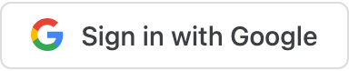
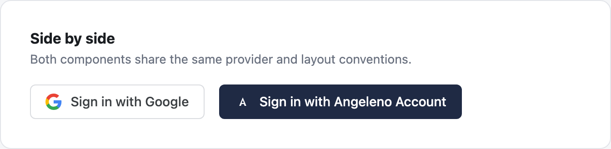
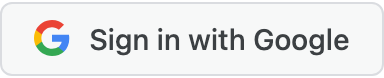

# @sindhupokala-ladot/common-auth-components

Reusable React sign-in components for applications that authenticate through the City
of Los Angeles's **Common Auth Backend**: `GoogleSignInButton` for Internal (City
staff) applications, `AngelenoSignInButton` for External (public-facing) applications
using **Angeleno Account**. Drop either one directly into your own application's own
page — there is no hosted login page to redirect users to first, and no CORS setup
required on your side.

If you're integrating a new application against Common Auth Backend, this README is
the whole story on the frontend half. For the backend half (exchanging the
authorization code Common Auth redirects back to you with), see
[Where this fits in the full login flow](#where-this-fits-in-the-full-login-flow)
below, and ask your Common Auth administrator for the backend integration guide.

---

## Before you start

You need three things from a Common Auth administrator, obtained by onboarding your
application through **Common Auth Portal**:

1. **Common Auth Backend's base URL** — the same value for every application.
2. **Your application's client ID** — one for Google (if you're an Internal
   application) or Angeleno Account (if you're an External application).
3. **A registered redirect URI** — a URL on your own application that Common Auth
   Backend is allowed to send users back to after they sign in.

Each application gets its **own** Google or Angeleno Account client — credentials are
never shared between applications, even two Internal applications both using Google.

---

## Install

This package is published to **GitHub Packages** under the `sindhupokala-ladot`
GitHub account, not the public npm registry. Add a `.npmrc` file to your application
(next to its `package.json`) that points the `@sindhupokala-ladot` scope at GitHub's
registry:

```ini
@sindhupokala-ladot:registry=https://npm.pkg.github.com
//npm.pkg.github.com/:_authToken=${GITHUB_TOKEN}
```

`GITHUB_TOKEN` needs to be a personal access token (classic or fine-grained) with at
least the `read:packages` scope, exported in whatever shell/CI environment runs
`npm install` — GitHub Packages requires authentication to _install_ a package even
from a public repository.

Then install as usual:

```bash
npm install @sindhupokala-ladot/common-auth-components
```

---

## Quick start

Wrap the part of your page that renders a sign-in button in `CommonAuthProvider`, then
render the button for your application type.

### Internal applications — Google

```tsx
import { CommonAuthProvider, GoogleSignInButton } from '@sindhupokala-ladot/common-auth-components'

function LoginPage() {
  return (
    <CommonAuthProvider apiBaseUrl="https://common-auth.example.com">
      <GoogleSignInButton
        clientId="your-application's-google-client-id"
        redirectUri="https://your-app.example.com/auth/callback"
      />
    </CommonAuthProvider>
  )
}
```



### External applications — Angeleno Account

```tsx
import { CommonAuthProvider, AngelenoSignInButton } from '@sindhupokala-ladot/common-auth-components'

function LoginPage() {
  return (
    <CommonAuthProvider apiBaseUrl="https://common-auth.example.com">
      <AngelenoSignInButton
        clientId="your-application's-angeleno-client-id"
        redirectUri="https://your-app.example.com/auth/callback"
      />
    </CommonAuthProvider>
  )
}
```


Both components render identically in layout and only ever appear on their respective
application type's own page — an Internal application never renders
`AngelenoSignInButton`, and vice versa.



---

## What happens when a user clicks

Both buttons render as a plain `<a href>`, **not** a `<button onClick>` that calls
`fetch`. Clicking one is a full-page, top-level redirect straight to Common Auth
Backend's authorize endpoint, which in turn redirects to Google or Angeleno Account.
This is deliberate:

- It works with JavaScript disabled or slow to load, and supports the browser's native
  "open in new tab" / "copy link" on the button.
- Because it's a top-level navigation rather than an XHR/`fetch` call, it is **never
  subject to CORS** — your application's origin does not need to be added to Common
  Auth Backend's CORS allow-list just to show a sign-in button.
- After the user signs in, Common Auth Backend redirects them back to your
  `redirectUri` with an authorization code — see the next section for what your own
  backend needs to do with it.

---

## Where this fits in the full login flow

This package only covers step 1 below. Steps 2–4 happen outside this package, on
infrastructure your Common Auth administrator will help you set up:

1. **This package** renders the button and builds the redirect URL to Common Auth
   Backend's authorize endpoint.
2. The user signs in with Google or Angeleno Account. Common Auth Backend redirects
   the browser back to your registered `redirectUri`, with an authorization `code`
   query parameter.
3. **Your own backend** takes that `code` and calls Common Auth Backend's token
   endpoint (`POST /api/oauth/token`) with your application's own `clientId` and
   `clientSecret` (issued once, when your application was registered — never exposed
   to the frontend) to exchange it for the signed-in user's identity.
4. Your backend does whatever it normally does after authenticating a user — mint
   its own session token, set a cookie, etc.

Ask your Common Auth administrator for the backend integration guide covering step 3
in full request/response detail, including every failure mode (expired code, redirect
URI mismatch, etc.).

---

## `CommonAuthProvider`

```tsx
<CommonAuthProvider apiBaseUrl="https://common-auth.example.com">
  {/* GoogleSignInButton / AngelenoSignInButton go anywhere inside here */}
</CommonAuthProvider>
```

| Prop         | Type     | Required | Description                                                     |
| ------------ | -------- | -------- | --------------------------------------------------------------- |
| `apiBaseUrl` | `string` | Yes      | Common Auth Backend's base URL. The same for every application. |

You only need one `CommonAuthProvider`, wrapping whichever part of your component tree
renders sign-in buttons — typically just your login page, or your whole app if it's
simpler to do that.

Rendering `GoogleSignInButton` or `AngelenoSignInButton` outside a `CommonAuthProvider`
throws immediately, with a message telling you what's missing — this is intentional, so
a misconfigured page fails loudly in development rather than silently rendering a
button that redirects to a broken URL.

---

## `GoogleSignInButton`

| Prop          | Type     | Required | Description                                                                                      |
| ------------- | -------- | -------- | ------------------------------------------------------------------------------------------------ |
| `clientId`    | `string` | Yes      | This application's Google client ID (Internal applications only).                                |
| `redirectUri` | `string` | Yes      | Must exactly match one of this application's registered redirect URIs.                           |
| `state`       | `string` | No       | Opaque value round-tripped back to `redirectUri` unchanged — e.g. a post-login destination path. |
| `label`       | `string` | No       | Overrides the default "Sign in with Google" text.                                                |

Any other prop (`className`, `style`, `id`, ...) passes straight through to the
underlying `<a>` element.

**Hover state:**



---

## `AngelenoSignInButton`

Angeleno Account is a real, Auth0-backed identity platform, not a placeholder — Common
Auth Backend verifies every `id_token` it issues against Angeleno Account's own
published signing keys before trusting any of its claims. Nothing about that
verification is visible from this component; it's entirely a Common Auth Backend
concern.

| Prop          | Type     | Required | Description                                                                 |
| ------------- | -------- | -------- | --------------------------------------------------------------------------- |
| `clientId`    | `string` | Yes      | This application's Angeleno Account client ID (External applications only). |
| `redirectUri` | `string` | Yes      | Must exactly match one of this application's registered redirect URIs.      |
| `state`       | `string` | No       | Opaque value round-tripped back to `redirectUri` unchanged.                 |
| `label`       | `string` | No       | Overrides the default "Sign in with Angeleno Account" text.                 |

Any other prop (`className`, `style`, `id`, ...) passes straight through to the
underlying `<a>` element.

The package also exports `ANGELENO_ACCOUNT_TAGLINE` — the City's approved tagline
("Your one account to access City of Los Angeles services.") to display near the
button, if your page design calls for it. It's a plain string constant, not baked into
the button, since placement is a page layout decision:

```tsx
import { AngelenoSignInButton, ANGELENO_ACCOUNT_TAGLINE } from '@sindhupokala-ladot/common-auth-components'

<AngelenoSignInButton clientId="..." redirectUri="..." />
<p>{ANGELENO_ACCOUNT_TAGLINE}</p>
```

**Hover state:**


---

## Customizing the label

```tsx
<GoogleSignInButton clientId="..." redirectUri="..." label="Continue with your work account" />
```

There is currently no prop for restyling colors/borders beyond the `style`/`className`
passthrough — the components ship with one look, matching how Material UI's own
`Button` is used unstyled far more often than themed. If your application needs a
materially different look, `style` overrides win over the component's own inline
defaults (later object keys win when both set the same CSS property).

---

## Why no stylesheet to import

Unlike most component libraries, there is no CSS file to import alongside these
components. All styling — including the hover-state background change shown above — is
applied via inline styles computed in the component itself. This is a deliberate
trade-off: a button meant to be dropped into an _unknown_ host application's page
should not depend on that application remembering a separate
`import '@sindhupokala-ladot/common-auth-components/styles.css'` step. One `npm install`
and one `import` is the entire integration surface.

---

## Troubleshooting

| Symptom                                                                                  | Likely cause                                                                                                                                                   |
| ---------------------------------------------------------------------------------------- | -------------------------------------------------------------------------------------------------------------------------------------------------------------- |
| Thrown error mentioning `CommonAuthProvider`                                             | The button was rendered without a `CommonAuthProvider` ancestor.                                                                                               |
| Clicking the button redirects, but Common Auth Backend shows an error page               | `redirectUri` doesn't exactly match a URI registered for this application in Common Auth Portal — check for a trailing slash or `http` vs `https` mismatch.    |
| Clicking the button redirects, but the provider (Google/Angeleno Account) shows an error | The application's Google/Angeleno Account client isn't configured yet, or is configured but not yet marked active — check with your Common Auth administrator. |
| `npm install` fails with `404 Not Found` or `401/403` for this package                   | Your `.npmrc` is missing, misconfigured, or `GITHUB_TOKEN` doesn't have `read:packages` scope — see [Install](#install).                                       |

---

## Local development

Clone this repository, then:

```bash
npm install
npm run dev     # playground - renders both buttons for visual/screenshot review at http://localhost:5173
```

Other scripts:

```bash
npm run build           # compiles src/ to dist/ (the published entry point)
npm test                # Vitest + Testing Library
npx tsc -b               # type-check (playground + tests included)
npm run lint             # oxlint
npm run format:check     # Prettier
```

`npm run build`, `npm test`, and type-checking all run in CI on every push and pull
request (`.github/workflows/ci.yml`).

---

## Releasing a new version

1. Bump `"version"` in `package.json` (semver).
2. Merge that change to `main`.
3. Cut a GitHub Release (tag matching the new version, e.g. `v0.0.2`).

Publishing `.github/workflows/publish.yml` triggers on `release: published` and runs
build + test before publishing to GitHub Packages — nothing manual to run locally, and
no personal access token needed for the publish step itself (it uses the workflow's own
`GITHUB_TOKEN`, scoped to `packages: write` for this repo only).

---

## License

License to be confirmed by the City of Los Angeles. Do not treat the absence of a
`LICENSE` file as permission to redistribute outside City of Los Angeles projects —
check with the repository owner before relying on this package outside an
onboarded City application.
